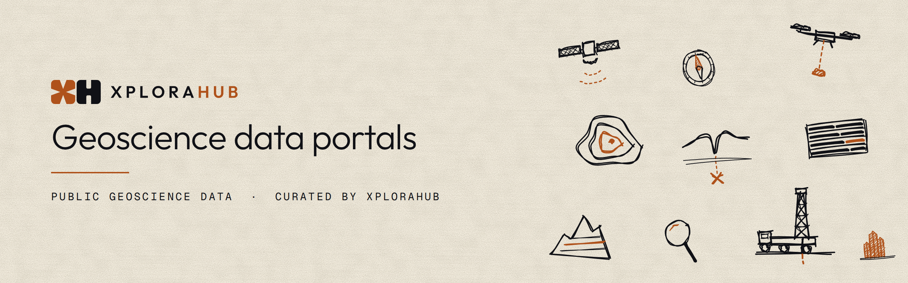

# Geoscience data portals

> Where to find public geoscience data, and what to check before you use it.

A catalogue of government geoscience data portals for mineral exploration. For each portal: what it holds, how to get the data, the licence, what to watch out for and when someone last checked it. <!-- count:start -->76<!-- count:end --> portals across Australia, Canada, the United States, the UK and Ireland, Sweden, Finland, Norway, Greenland, Saudi Arabia and India.

The list is not complete. It started with national surveys and the main mining states and provinces, and some are still missing (in the US, for example, Utah, Wyoming and New Mexico). [Suggest a portal](../../issues/new?template=new-portal.yml). Mining title registers (tenement and claim systems) are out of scope unless a geoscience portal also holds them. Not every portal here is open data: check each licence.

Curated by [XploraHub](https://xplorahub.com), open ground for exploration & mining technology. For open-source software, see [Awesome mineral exploration](https://github.com/XploraHub/awesome-mineral-exploration).

## Use the data

- [`portals.csv`](portals.csv): one row per portal.
- [`endpoints.csv`](endpoints.csv): one row per way in (download, viewer, WMS, WFS and so on).
- [`portals.geojson`](portals.geojson): one point per portal, at the centre of its country or state. [See them on a map](portals.geojson): GitHub draws the file as one.
- [`qgis/wms-connections.xml`](qgis/wms-connections.xml) and [`qgis/wfs-connections.xml`](qgis/wfs-connections.xml): every WMS and WFS service, ready to load in QGIS (Data Source Manager, WMS or WFS tab, Load).
- [`data/`](data): the source files, one per portal.

The tables below and the files above are generated from `data/`. Each portal's checked date links to its file, which lists the sources for every claim.

## Portals

<!-- portals:start -->
### Australia

| Portal | Holds | Access | Licence | Checked |
|---|---|---|---|---|
| [AuScope Discovery Portal](https://portal.auscope.org.au/) | geological maps, mineral occurrences, drillholes, surface geochemistry, magnetics, gravity, radiometrics, magnetotellurics, seismic, geochronology, tenements, remote sensing, 3D models, publications | map viewer, API | not stated | [2026-11-06](data/AU/auscope-discovery-portal.yaml) |
| [Exploring for the Future Data Discovery Portal](https://portal.ga.gov.au/persona/eftf) | electromagnetics, magnetotellurics, surface geochemistry, drillholes | map viewer, WMS, download | CC BY 4.0 | [2026-11-06](data/AU/ga-eftf-portal.yaml) |
| [Geophysical Archive Data Delivery System (GADDS)](https://portal.ga.gov.au/persona/gaddsResources) | magnetics, radiometrics, gravity, elevation | download | not stated | [2026-11-06](data/AU/ga-gadds.yaml) |
| [Geoscience Australia Portal](https://portal.ga.gov.au) | geological maps, mineral occurrences, surface geochemistry, magnetics, gravity, radiometrics, electromagnetics, magnetotellurics, geochronology | map viewer | CC BY 4.0 | [2026-11-06](data/AU/ga-portal.yaml) |
| [Company Mineral Drillhole and Surface Geochemistry Database (MDHDB)](https://wa.gov.au/service/natural-resources/mineral-resources/access-company-mineral-drillhole-and-surface-geochemistry-database) (Western Australia) | drillholes, drillhole assays, surface geochemistry | map viewer, bulk download | not stated | [2026-11-07](data/AU-WA/wa-mdhdb.yaml) |
| [DMPE eBookshop (GSWA publications)](https://www.wa.gov.au/organisation/department-of-mines-petroleum-and-exploration/geological-survey-of-western-australia/dmpe-ebookshop) (Western Australia) | publications, geological maps, surface geochemistry | download, order (paid) | not stated | [2026-11-06](data/AU-WA/wa-gswa-ebookshop.yaml) |
| [DMPE map services on Data WA (SLIP)](https://data.wa.gov.au/slip) (Western Australia) | geological maps, mineral occurrences, drillholes, surface geochemistry, geochronology, tenements, company reports, magnetics, radiometrics, gravity, seismic, core library | WMS, WFS, ArcGIS REST | CC BY 4.0 | [2026-11-06](data/AU-WA/wa-datawa-slip.yaml) |
| [Data and Software Centre (DASC)](https://dasc.dmirs.wa.gov.au) (Western Australia) | geological maps, drillholes, drillhole assays, surface geochemistry, magnetics, gravity, radiometrics, mineral occurrences, tenements | bulk download | CC BY 4.0 | [2026-11-06](data/AU-WA/wa-dasc.yaml) |
| [GSWA Geochemistry (WACHEM)](https://catalogue.data.wa.gov.au/dataset/gswa-geochemistry) (Western Australia) | surface geochemistry, drillhole assays | bulk download, WMS, WFS, ArcGIS REST | CC BY 4.0 | [2026-11-07](data/AU-WA/wa-gswa-geochemistry.yaml) |
| [GeoVIEW.WA](https://www.wa.gov.au/service/natural-resources/mineral-resources/search-geoscience-and-titles-information-geoviewwa) (Western Australia) | geological maps, mineral occurrences, drillholes, surface geochemistry, geochronology, tenements, company reports, publications | map viewer, download | not stated | [2026-11-06](data/AU-WA/wa-geoview.yaml) |
| [MAGIX geophysical survey register](https://www.wa.gov.au/service/natural-resources/mineral-resources/access-magix-online) (Western Australia) | magnetics, radiometrics, gravity, electromagnetics, magnetotellurics, seismic | download, order (paid), WMS, WFS | not stated | [2026-11-06](data/AU-WA/wa-magix.yaml) |
| [MINEDEX (Mines and Mineral Deposits)](https://www.wa.gov.au/service/natural-resources/mineral-resources/access-mines-and-mineral-deposits-minedex) (Western Australia) | mineral occurrences | map viewer, bulk download, WMS, WFS | not stated | [2026-11-06](data/AU-WA/wa-minedex.yaml) |
| [WAMEX mineral exploration reports](https://wamex.dmp.wa.gov.au/Wamex) (Western Australia) | company reports, drillholes, surface geochemistry, 3D models | download, by email | not stated | [2026-11-07](data/AU-WA/wa-wamex.yaml) |
| [SARIG (South Australian Resources Information Gateway)](https://map.sarig.sa.gov.au) (South Australia) | geological maps, drillholes, drillhole assays, surface geochemistry, petrophysics, mineral occurrences, company reports, core library | map viewer, bulk download | CC BY 4.0 | [2026-11-06](data/AU-SA/sa-sarig.yaml) |
| [GSQ Open Data Portal](https://geoscience.data.qld.gov.au) (Queensland) | drillholes, surface geochemistry, magnetics, gravity, radiometrics, seismic, mineral occurrences, geological maps, company reports, remote sensing, 3D models | download, CKAN | CC BY 4.0 | [2026-11-07](data/AU-QLD/qld-gsq-open-data-portal.yaml) |
| [GeoResGlobe](https://www.business.qld.gov.au/industries/mining-energy-water/resources/minerals-coal/online-services/georesglobe) (Queensland) | tenements, geological maps, drillholes, mineral occurrences, magnetics, gravity, radiometrics, seismic, magnetotellurics, company reports | map viewer, ArcGIS REST | not stated | [2026-11-06](data/AU-QLD/qld-georesglobe.yaml) |
| [DIGS (exploration reports)](https://search.geoscience.nsw.gov.au) (New South Wales) | company reports, publications | download | not stated | [2026-11-06](data/AU-NSW/nsw-digs.yaml) |
| [MinView](https://minview.geoscience.nsw.gov.au) (New South Wales) | geological maps, mineral occurrences, drillholes, drillhole assays, surface geochemistry, magnetics, gravity, radiometrics, seismic, geochronology, tenements | map viewer, download | CC BY 4.0 | [2026-11-06](data/AU-NSW/nsw-minview.yaml) |
| [GeoVic](https://resources.vic.gov.au/geology-and-data/maps-reports-data/geovic) (Victoria) | geological maps, drillholes, surface geochemistry, mineral occurrences, tenements, core library | map viewer, map viewer (free login), download, WFS | CC BY 4.0 | [2026-11-07](data/AU-VIC/vic-geovic.yaml) |
| [Mineral Resources Tasmania digital data](https://mrt.tas.gov.au/products/digital_data) (Tasmania) | geological maps, drillholes, surface geochemistry, magnetics, radiometrics, gravity, tenements, company reports | download, WMS, WFS | CC BY 3.0 AU | [2026-11-06](data/AU-TAS/tas-mrt.yaml) |
| [GEMIS](https://geoscience.nt.gov.au/gemis/) (Northern Territory) | company reports, drillholes, drillhole assays, surface geochemistry, magnetics, publications | download | not stated | [2026-11-06](data/AU-NT/nt-gemis.yaml) |
| [STRIKE](https://nt.gov.au/industry/geoscience/online-geoscience-information-systems) (Northern Territory) | geological maps, drillholes, surface geochemistry, mineral occurrences, tenements | map viewer | not stated | [2026-11-07](data/AU-NT/nt-strike.yaml) |

### Canada

| Portal | Holds | Access | Licence | Checked |
|---|---|---|---|---|
| [Canadian Database of Geochemical Surveys (CDoGS)](https://geochem.nrcan.gc.ca/cdogs/content/main/home_en.htm) | surface geochemistry, publications | map viewer, download, WMS | OGL Canada 2.0 | [2026-11-06](data/CA/ca-cdogs.yaml) |
| [Geophysical Data (Geoscience Data Repository)](https://geophysical-data.canada.ca) | magnetics, electromagnetics, gravity, radiometrics | download | OGL Canada 2.0 | [2026-11-06](data/CA/ca-gdr.yaml) |
| [NRCan Open S&T Repository (OSTR), formerly GEOSCAN](https://ostrnrcan-dostrncan.canada.ca) | publications | download | not stated | [2026-11-06](data/CA/ca-ostr.yaml) |
| [ARIS Assessment Report Indexing System](https://apps.nrs.gov.bc.ca/pub/aris/) (British Columbia) | company reports, drillholes, surface geochemistry, magnetics, electromagnetics, gravity, radiometrics | map viewer, WMS, WFS | access only (BC) | [2026-11-06](data/CA-BC/bc-aris.yaml) |
| [Assessment report drillhole database (BCGS GeoFile 2025-11 and 2026-11)](https://cmscontent.nrs.gov.bc.ca/geoscience/PublicationCatalogue/GeoFile/BCGS_GF2026-11.pdf) (British Columbia) | drillholes, drillhole assays | download | not stated | [2026-11-06](data/CA-BC/bc-aris-drillholes.yaml) |
| [MINFILE Mineral Inventory](https://minfile.gov.bc.ca) (British Columbia) | mineral occurrences | map viewer, bulk download, WMS, WFS | access only (BC) | [2026-11-06](data/CA-BC/bc-minfile.yaml) |
| [MapPlace 2](https://www2.gov.bc.ca/gov/content/industry/mineral-exploration-mining/british-columbia-geological-survey/mapplace) (British Columbia) | geological maps, mineral occurrences | map viewer, WMS, WFS | not stated | [2026-11-06](data/CA-BC/bc-mapplace.yaml) |
| [Yukon Geological Survey integrated data system](https://data.geology.gov.yk.ca) (Yukon) | mineral occurrences, company reports, publications, geological maps, surface geochemistry, drillholes, geochronology, petrophysics, tenements | map viewer, bulk download, ArcGIS REST | OGL Yukon | [2026-11-06](data/CA-YT/yt-ygs-data.yaml) |
| [NTGS Web Apps (References, NORMIN showings, KIDD, KANDD)](https://app.nwtgeoscience.ca/) (Northwest Territories) | company reports, publications, mineral occurrences, drillholes, surface geochemistry, core library | map viewer, download | NWT terms (non-commercial) | [2026-11-06](data/CA-NT/nwt-ntgs-apps.yaml) |
| [NunavutGeoscience.ca (NUMIN)](https://nunavutgeoscience.ca/en/) (Nunavut) | mineral occurrences, company reports, publications, geological maps | map viewer, download | not stated | [2026-11-06](data/CA-NU/nu-numin.yaml) |
| [Alberta metallic and industrial mineral assessment reports](https://www.alberta.ca/metallic-and-industrial-mineral-assessment-report-searches) (Alberta) | company reports | map viewer | not stated | [2026-11-06](data/CA-AB/ab-mars.yaml) |
| [Data extracted from Alberta mineral assessment reports (AGS)](https://ags.aer.ca/our-science/mineral-resources/mineral-exploration) (Alberta) | drillholes, drillhole assays, surface geochemistry, radiometrics, company reports | download, map viewer | OGL Alberta | [2026-11-06](data/CA-AB/ab-ags-mar-data.yaml) |
| [Saskatchewan Geoscience Data System (GeoDS)](https://www.saskatchewan.ca/business/agriculture-natural-resources-and-industry/mineral-exploration-and-mining/saskatchewan-geological-survey/saskatchewan-geoscience-data-system) (Saskatchewan) | company reports, drillholes, surface geochemistry | map viewer, ArcGIS REST | not stated | [2026-11-06](data/CA-SK/sk-geods.yaml) |
| [Saskatchewan Mining and Petroleum GeoAtlas, SMDI and SMAD](https://www.saskatchewan.ca/business/agriculture-natural-resources-and-industry/mineral-exploration-and-mining/saskatchewan-geological-survey) (Saskatchewan) | geological maps, mineral occurrences, company reports, tenements | map viewer, download | not stated | [2026-11-06](data/CA-SK/sk-geoatlas.yaml) |
| [Manitoba GIS Map Gallery and geological databases](https://www.manitoba.ca/iem/geo/gis/index.html) (Manitoba) | geological maps, mineral occurrences, drillholes, company reports, magnetics, geochronology, surface geochemistry, tenements, publications | map viewer, ArcGIS REST, download | not stated | [2026-11-06](data/CA-MB/mb-map-gallery.yaml) |
| [GeologyOntario](https://www.geologyontario.mines.gov.on.ca/) (Ontario) | company reports, drillholes, mineral occurrences, geological maps | map viewer, download, ArcGIS REST, WMS | Crown copyright (Ontario) | [2026-11-06](data/CA-ON/on-geologyontario.yaml) |
| [Ontario Drill Hole Database (ODHD)](https://data.ontario.ca/dataset/ontario-drill-hole-database) (Ontario) | drillholes | download, map viewer | Crown copyright (Ontario) | [2026-11-06](data/CA-ON/on-odhd.yaml) |
| [SIGÉOM (Système d'information géominière du Québec)](https://sigeom.mines.gouv.qc.ca) (Quebec) | geological maps, mineral occurrences, drillholes, surface geochemistry, geochronology, magnetics, radiometrics, electromagnetics, petrophysics, company reports, publications | map viewer, bulk download, WMS, CKAN | CC BY 4.0 | [2026-11-06](data/CA-QC/qc-sigeom.yaml) |
| [New Brunswick Geological Survey open data](https://www2.gnb.ca/content/gnb/en/departments/erd/open-data/metallic-minerals.html) (New Brunswick) | mineral occurrences, drillholes, company reports, tenements, geological maps, geochronology, surface geochemistry | ArcGIS REST, download | OGL New Brunswick | [2026-11-06](data/CA-NB/nb-nbgs-open-data.yaml) |
| [Nova Scotia Mineral Occurrence and Drillhole Databases](https://novascotia.ca/natr/meb/mineral-resources/mineral-occurrences.asp) (Nova Scotia) | mineral occurrences, drillholes, surface geochemistry, core library | download, map viewer, ArcGIS REST | OGL Nova Scotia | [2026-11-06](data/CA-NS/ns-modb-drillholes.yaml) |
| [Newfoundland and Labrador GeoScience Atlas, MODS and GeoFiles](https://gis.geosurv.gov.nl.ca/) (Newfoundland and Labrador) | geological maps, surface geochemistry, mineral occurrences, company reports, tenements, publications | map viewer, download, by email | not stated | [2026-11-06](data/CA-NL/nl-geoscience-atlas.yaml) |

### United States

| Portal | Holds | Access | Licence | Checked |
|---|---|---|---|---|
| [Earth MRI data releases](https://www.usgs.gov/special-topics/earth-mri) | magnetics, radiometrics, electromagnetics, surface geochemistry, geological maps | download, WMS, WFS | public domain (US) | [2026-11-06](data/US/us-earth-mri.yaml) |
| [Mineral Resources Online Spatial Data (MRDS, NGDB rock, NURE-HSSR)](https://mrdata.usgs.gov/) | mineral occurrences, surface geochemistry | map viewer, bulk download, WMS, WFS | public domain (US) | [2026-11-06](data/US/us-mrdata.yaml) |
| [National Geologic Map Database (NGMDB)](https://ngmdb.usgs.gov/ngmdb/ngmdb_home.html) | geological maps, publications | download, map viewer | not stated | [2026-11-06](data/US/us-ngmdb.yaml) |
| [USGS Geochemical Data Portal (rock, sediment, soil and mineral samples)](https://www.usgs.gov/tools/geochemical-data-portal-rock-sediment-soil-and-mineral-samples-united-states-and-territories) | surface geochemistry | map viewer, bulk download | public domain (US) | [2026-11-06](data/US/us-geochemical-data-portal.yaml) |
| [USMIN Mineral Deposit Database](https://mrdata.usgs.gov/deposit/) | mineral occurrences | map viewer, download, WMS, WFS | public domain (US) | [2026-11-06](data/US/us-usmin.yaml) |
| [Nevada Bureau of Mines and Geology data and mining district files](https://nbmg.unr.edu/Maps&Data/index.html) (Nevada) | mineral occurrences, company reports, geological maps, surface geochemistry, publications | download, map viewer, ArcGIS REST | not stated | [2026-11-06](data/US-NV/nv-nbmg.yaml) |
| [AZGS Document Repository and Mining Data (AZLibrary)](https://library.azgs.arizona.edu/) (Arizona) | publications, geological maps, company reports, mineral occurrences | download, API | CC BY-NC-SA 4.0 (non-commercial) | [2026-11-06](data/US-AZ/az-azgs.yaml) |
| [Alaska DGGS geochemistry, geophysics and Geologic Materials Center](https://dggs.alaska.gov/maps-data/interactive-maps.html) (Alaska) | surface geochemistry, magnetics, electromagnetics, radiometrics, gravity, core library, publications | map viewer, download, ArcGIS REST | not stated | [2026-11-06](data/US-AK/ak-dggs.yaml) |
| [Alaska Resource Data File (ARDF)](https://mrdata.usgs.gov/ardf/) (Alaska) | mineral occurrences | map viewer, download, WMS, WFS | public domain (US) | [2026-11-06](data/US-AK/ak-ardf.yaml) |
| [Minnesota DNR Drill Core Library and mineral exploration documents](https://gis.data.mn.gov/datasets/ff548af5cbba4259966882b17539ce82) (Minnesota) | drillholes, core library, company reports | download, ArcGIS REST | non-commercial (Minnesota) | [2026-11-06](data/US-MN/mn-dnr-minerals.yaml) |
| [Database of the Mines and Prospects of Idaho (DD-1)](https://www.idahogeology.org/product/dd-1) (Idaho) | mineral occurrences, company reports | map viewer, bulk download, order (paid) | not stated | [2026-11-06](data/US-ID/id-igs-mines.yaml) |
| [Montana Bureau of Mines and Geology publications and analytical datasets](https://mbmg.mtech.edu/mbmgcat/public/BrowseCatalog.asp) (Montana) | surface geochemistry, geochronology, publications, geological maps | download, map viewer | not stated | [2026-11-06](data/US-MT/mt-mbmg.yaml) |
| [Michigan DNR mineral leases](https://gis-michigan.opendata.arcgis.com/maps/midnr::michigan-dnr-mineral-leases) (Michigan) | tenements | download, ArcGIS REST | not stated | [2026-11-06](data/US-MI/mi-dnr-mineral-leases.yaml) |
| [Michigan Geological Repository for Research and Education (MGRRE)](https://mgs.wmich.edu/michigan-geological-repository-for-research-and-education) (Michigan) | core library, drillholes, geological maps | map viewer, download | not stated | [2026-11-06](data/US-MI/mi-mgs-mgrre.yaml) |

### United Kingdom

| Portal | Holds | Access | Licence | Checked |
|---|---|---|---|---|
| [BGS GeoIndex (onshore)](https://www.bgs.ac.uk/map-viewers/geoindex-onshore/) | geological maps, drillholes, surface geochemistry, mineral occurrences, magnetics, gravity, seismic, core library | map viewer, WMS, ArcGIS REST | OGL UK 3.0 | [2026-11-06](data/GB/gb-bgs-geoindex.yaml) |
| [BGS OpenGeoscience](https://www.bgs.ac.uk/geological-data/opengeoscience/) | geological maps, drillholes, publications | download, WMS | BGS licences (vary) | [2026-11-06](data/GB/gb-bgs-opengeoscience.yaml) |
| [GSNI GeoIndex](https://www.bgs.ac.uk/geology-projects/gsni/) (Northern Ireland) | geological maps, mineral occurrences, tenements, magnetics, radiometrics, electromagnetics, gravity, surface geochemistry, drillholes | map viewer, WMS, ArcGIS REST | not stated | [2026-11-06](data/GB-NIR/gb-nir-gsni-geoindex.yaml) |
| [GSNI open data on Open Data NI (Tellus and minerals)](https://www.opendatani.gov.uk/) (Northern Ireland) | magnetics, radiometrics, electromagnetics, surface geochemistry, geological maps, core library | CKAN, download | OGL UK 3.0 | [2026-11-06](data/GB-NIR/gb-nir-tellus-opendatani.yaml) |

### Ireland

| Portal | Holds | Access | Licence | Checked |
|---|---|---|---|---|
| [Geological Survey Ireland minerals data](https://gsi.ie/data-and-maps/minerals/) | mineral occurrences, drillholes, surface geochemistry, company reports, core library | map viewer, download, WMS, ArcGIS REST | CC BY 4.0 | [2026-11-06](data/IE/ie-gsi-minerals.yaml) |
| [Tellus (Geological Survey Ireland)](https://gsi.ie/programmes-projects/tellus/) | magnetics, radiometrics, electromagnetics, surface geochemistry | download, ArcGIS REST, WMS | CC BY 4.0 | [2026-11-06](data/IE/ie-gsi-tellus.yaml) |

### Sweden

| Portal | Holds | Access | Licence | Checked |
|---|---|---|---|---|
| [SGU geological data](https://www.sgu.se/en/products/geological-data/) | mineral occurrences, drillholes, core library, tenements, geological maps, magnetics, radiometrics, gravity, electromagnetics, seismic, petrophysics | map viewer, bulk download, OGC API, WMS | CC0 | [2026-11-06](data/SE/se-sgu.yaml) |

### Finland

| Portal | Holds | Access | Licence | Checked |
|---|---|---|---|---|
| [Hakku (GTK search and download service)](https://hakku.gtk.fi/en) | publications, company reports, geological maps, mineral occurrences, drillholes, drillhole assays, petrophysics, magnetics | download, order (paid) | CC BY 4.0 | [2026-11-06](data/FI/fi-gtk-hakku.yaml) |
| [Mineral Deposits and Exploration (MDaE) map service](https://gtkdata.gtk.fi/mdae/) | mineral occurrences, drillholes, core library, magnetics, gravity, geological maps | map viewer, ArcGIS REST, WMS | CC BY 4.0 | [2026-11-06](data/FI/fi-gtk-mdae.yaml) |

### Norway

| Portal | Holds | Access | Licence | Checked |
|---|---|---|---|---|
| [NGU Geoscience Portal](https://geo.ngu.no/geoscienceportalopen/search) | magnetics, radiometrics, electromagnetics, gravity, petrophysics | map viewer, download, WMS | NLOD 2.0 | [2026-11-06](data/NO/no-ngu-geoscience-portal.yaml) |
| [NGU mineral resources database](https://geo.ngu.no/kart/mineralressurser_mobil/?lang=eng) | mineral occurrences | map viewer, WMS, download | NLOD 1.0 | [2026-11-06](data/NO/no-ngu-mineral-resources.yaml) |

### Greenland

| Portal | Holds | Access | Licence | Checked |
|---|---|---|---|---|
| [GEUS Dataverse - Greenland Data Centre](https://dataverse.geus.dk/dataverse/greenland_data_centre) | surface geochemistry, mineral occurrences, magnetics, electromagnetics, geological maps, company reports | download, API | GEUS terms (internal use) | [2026-11-06](data/GL/gl-geus-dataverse.yaml) |
| [Greenland Mineral Occurrence Map (GMOM) and Greenland Portal](https://greenmin.gl/) | mineral occurrences, geological maps, company reports | map viewer, WMS, WFS | CC BY 4.0 | [2026-11-06](data/GL/gl-geus-gmom.yaml) |

### Saudi Arabia

| Portal | Holds | Access | Licence | Checked |
|---|---|---|---|---|
| [National Geological Database (NGD) and portal](https://ngd.sgs.gov.sa/) | geological maps, mineral occurrences, surface geochemistry, magnetics, drillholes, core library, publications, company reports | map viewer, download (free login), by email | not stated | [2026-11-06](data/SA/sa-ngd.yaml) |
| [SGS technical reports, books and maps database](https://ngdp.sgs.gov.sa/biblioapp/) | publications, geological maps | map viewer | not stated | [2026-11-06](data/SA/sa-sgs-report-library.yaml) |
| [Taadeen mining platform](https://taadeen.sa/en) | tenements | map viewer, order (restricted) | not stated | [2026-11-06](data/SA/sa-taadeen.yaml) |

### India

| Portal | Holds | Access | Licence | Checked |
|---|---|---|---|---|
| [Bhukosh (GSI geoscience portal)](https://bhukosh.gsi.gov.in/Bhukosh/Public) *uncertain* | geological maps, mineral occurrences, magnetics, gravity, publications | map viewer, download (free login) | not stated | [2026-11-06](data/IN/in-gsi-bhukosh.yaml) |
| [National Geoscience Data Repository (NGDR)](https://geodataindia.gov.in/) | geological maps, surface geochemistry, magnetics, gravity, drillholes, company reports | map viewer (free login) | not stated | [2026-11-06](data/IN/in-ngdr.yaml) |
| [National Mineral Inventory (NMI)](https://ibm.gov.in/IBMPortal/pages/National-Mineral-Inventory) | mineral occurrences | order (paid), download | not stated | [2026-11-06](data/IN/in-ibm-nmi.yaml) |
<!-- portals:end -->

## How it is kept accurate

- Every entry lists the pages its claims come from, and the date someone last checked them. Where a portal could not be opened directly (it blocks automated access, or only answers from inside its own country), the entry says so in its caveats. Such an entry is marked *uncertain* in the tables.
- The build lists entries not checked for a year, so they can be checked again.
- Links are checked every night. A broken link updates one open issue; it does not delete the entry.
- A portal that closes is marked deprecated or superseded, never removed.
- Every WMS, WFS and ArcGIS REST address answered with its capabilities when it was checked, and each is asked again every night. A failure updates one open issue.
- "Not stated" means the portal names no licence. It does not mean free to use: ask the agency.
- Licences are recorded as each portal states them. Several are not open: some are non-commercial, internal use only or access only. Read the licence before you reuse data.

One caveat applies to every drillhole and geochemistry dataset here: samples sit where companies chose to explore. Ground with no data has usually not been tested; it is not evidence of no mineralisation. Models trained on these datasets can learn where people looked as well as where the ore is.

Connecting to a service, through QGIS or anything else, is using the agency's service: its terms apply, and so does the licence of any data you take from it. The files here only list public addresses; they copy no data.

Spotted something wrong or out of date? [Open an issue](../../issues/new/choose); no editing needed. To add a portal, see [CONTRIBUTING.md](CONTRIBUTING.md).

## Licence

The catalogue (everything in `data/` and the generated files) is under [CC BY 4.0](LICENSE): reuse it, including commercially, and credit "Geoscience data portals, XploraHub". The scripts are under the [MIT licence](LICENSE-CODE). The data in each portal belongs to its agency and keeps the agency's terms. The XploraHub name, logo and banner are not covered by either licence. XploraHub is not affiliated with any of these agencies, and the catalogue is provided as is, without warranty: check anything that matters at the source.
